<div align="center">

# Rust Video Parser

**全平台短视频解析服务 —— 高性能 · 安全可控 · 生产就绪**

[](https://www.rust-lang.org/)
[](https://github.com/tokio-rs/axum)
[](https://vuejs.org/)
[](#平台支持矩阵)
[](https://hub.docker.com/r/eginner01/rust_video_parser)
[](LICENSE)
[](#)

[概述](#概述) · [架构](#技术架构) · [快速开始](#快速开始) · [配置](#配置参考) · [命令行](#命令行接口) · [HTTP API](#http-api-参考) · [安全](#安全特性) · [可观测性](#可观测性与日志)

</div>

---

## 概述

Rust Video Parser 是一套面向生产环境的全平台短视频解析服务，基于 **Rust + Axum** 异步技术栈构建，前端采用 **Vue 3 + 自研 CSS 设计系统**。系统提供 **26 个**主流平台的无水印解析能力，覆盖视频、封面、图集、背景音乐及作者信息提取，并内置访问控制、限流、SSRF 防护、流式代理与结构化可观测性，可直接部署于企业内网或公有云。

### 核心能力

| 维度 | 说明 |
| --- | --- |
| 解析能力 | 26 个平台无水印解析，支持视频 / 图集 / 实况照片 / 封面 / 音乐 / 作者信息 |
| 运行性能 | 基于 Tokio 异步运行时，单进程高并发，毫秒级解析响应 |
| 资源占用 | 发布镜像约 50 MB（Alpine + 静态链接），秒级冷启动 |
| 访问控制 | 可选 Basic 认证、按 IP 限流、CORS 策略 |
| 网络安全 | 代理接口 SSRF 防护，拦截内网 / 保留 / 链路本地地址 |
| 流式传输 | 视频代理支持 HTTP Range 透传与流式转发，避免大文件占用内存 |
| 可观测性 | 结构化日志（本地时区时间戳 + 级别 + 模块 + 键值字段）、健康检查端点 |
| 运维友好 | 环境变量集中配置、出站代理、优雅关闭、非 root 容器运行 |

### 抖音实况照片

`v2.3.3` 增加抖音实况照片完整解析和网页预览能力。解析结果会同时保留静态照片与对应的动态视频，并尽量返回作品封面和背景音乐：

```json
{
  "music_url": "https://.../soundtrack",
  "cover_url": "https://.../cover.jpeg",
  "images": [
    {
      "url": "https://.../photo.jpeg",
      "live_photo_url": "https://.../live-photo.mp4"
    }
  ]
}
```

- 兼容抖音 Web 与 App 风格的多种图集字段结构。
- 使用完整详情数据识别 `live_photo_type`、`clip_type` 和图片内的视频资源。
- 严格区分图文背景音乐与实况视频，避免将音频误报为 `live_photo_url`。
- 网页灯箱支持“照片 / 实况”切换、循环预览和分别下载。
- 视频代理补齐抖音 CDN 来源请求头并支持 HTTP Range，可正常拖动播放。
- 普通视频和普通图集继续使用原有 `video_url`、`images[].url` 返回结构。

---

## 技术架构

### 分层架构

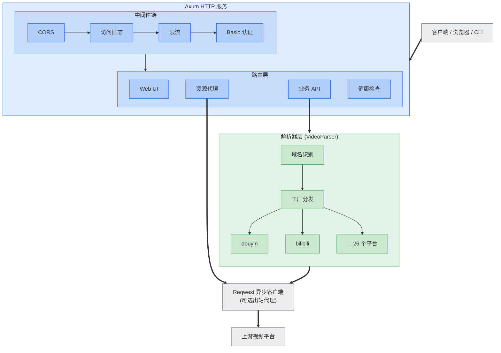

### 模块依赖

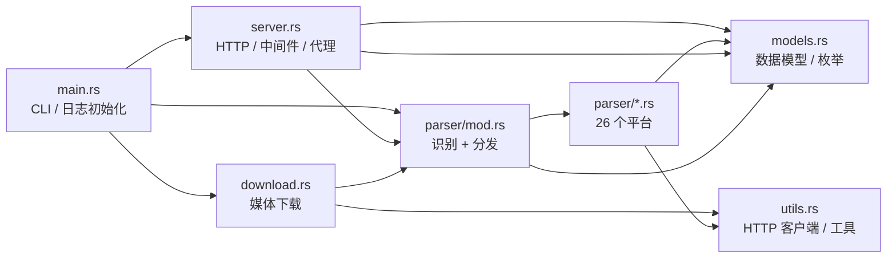

### 技术栈

| 层 | 组件 | 版本 | 职责 |
| --- | --- | --- | --- |
| 后端 | Rust | 1.75+ | 系统级语言，内存安全 |
| 后端 | Axum | 0.7 | 异步 Web 框架 |
| 后端 | Tokio | 1.x | 异步运行时 |
| 后端 | Reqwest | 0.11 | HTTP 客户端（含流式） |
| 后端 | Scraper / Regex | 0.18 / 1.10 | HTML 与文本提取 |
| 后端 | Tracing | 0.1 | 结构化日志 |
| 前端 | Vue | 3.4 | 渐进式前端框架 |
| 前端 | 自研 CSS | — | 设计令牌 + 亮/暗双主题（无 UI 框架） |
| 前端 | Vite | 5.0 | 构建工具 |
| 部署 | Docker | 多阶段 | 前端构建 + Rust 构建 + Alpine 运行时 |

### 请求处理流程

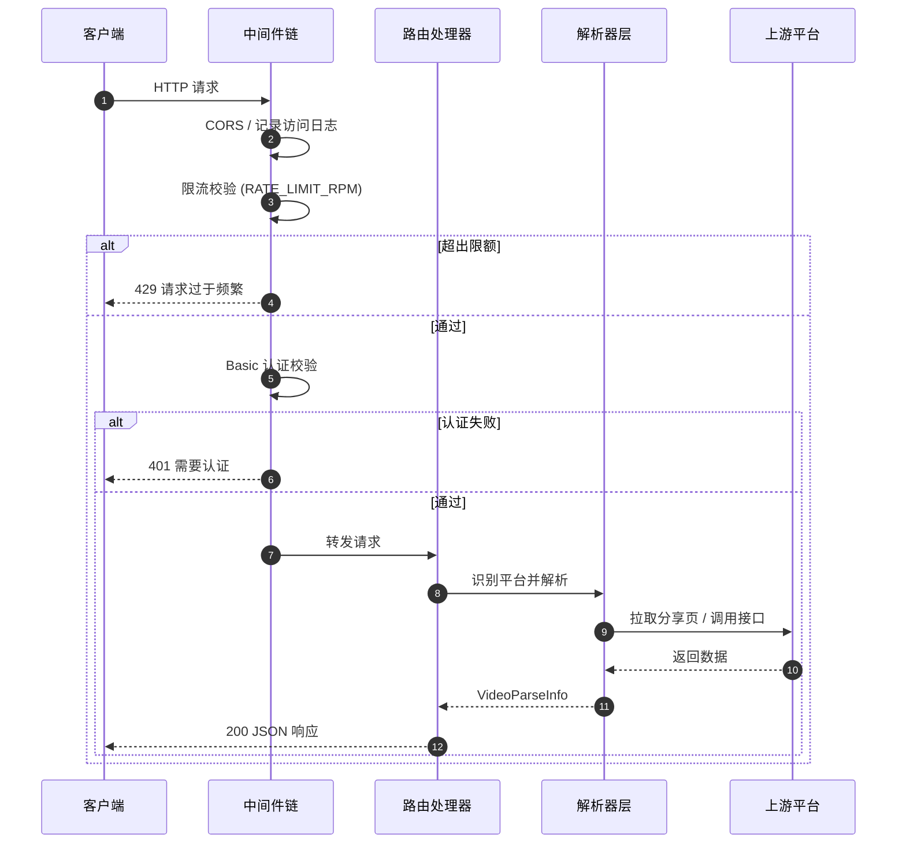

### 解析与分发

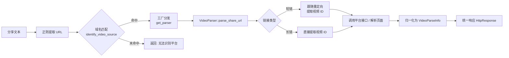

---

## 快速开始

### 部署拓扑

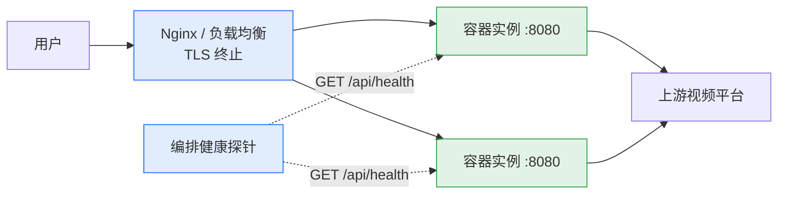

### 方式一：npm 安装 CLI（推荐用于命令行）

通过 npm 安装即可获得 `rust-video` 命令，无需本地工具链——安装时会按当前系统自动拉取匹配的预编译二进制：

```bash
npm install -g rust-video-parser

rust-video parse "https://v.douyin.com/xxxxxx/"
rust-video serve --port 8080        # 前端已内嵌，开箱即用
```

支持平台：win32-x64、darwin-x64、darwin-arm64、linux-x64、linux-arm64。其分发采用 `optionalDependencies` 预编译模型（各平台二进制独立成包，npm 依据 `os`/`cpu` 仅安装匹配项）。

### 方式二：Docker 镜像（推荐用于服务部署）

```bash
docker run -d \
  --name rust_video_parser \
  -p 8080:8080 \
  -e RUST_LOG=info \
  -e RATE_LIMIT_RPM=60 \
  --restart unless-stopped \
  eginner01/rust_video_parser:latest
```

固定使用本版本可将镜像标签改为 `eginner01/rust_video_parser:2.3.3`。

服务启动后访问 `http://localhost:8080`。

### 方式三：Docker Compose

仓库根目录已提供 `docker-compose.yml`，包含端口映射、资源限额与健康检查：

```bash
docker-compose up -d        # 启动
docker-compose ps           # 查看状态
docker-compose logs -f      # 跟踪日志
docker-compose down         # 停止并清理
```

### 方式四：源码构建

前置依赖：Rust 1.75+、Node.js 18+、npm 8+。

```bash
# 1. 构建前端静态资源（将被 rust-embed 编译期内嵌进二进制）
cd frontend
npm ci
npx vite build --outDir ../templates/dist
cd ..

# 2. 构建并启动后端
cargo build --release
./target/release/rust_video_parser serve --port 8080
```

> 提示：仓库仅提交 `templates/dist/.gitkeep` 占位以保证编译。未先构建前端时，`serve` 的页面为空（API 与 CLI 不受影响）；执行上面第 1 步后前端资源即被内嵌。

---

## 配置参考

所有运行参数通过环境变量集中管理，亦可写入项目根目录的 `.env` 文件（启动时自动加载）。

| 环境变量 | 默认值 | 说明 |
| --- | --- | --- |
| `SERVER_PORT` | `8080` | HTTP 监听端口，等价于 `--port` 参数 |
| `RUST_LOG` | `rust_video_parser=info,tower_http=warn` | 日志级别过滤（遵循 `tracing` EnvFilter 语法） |
| `RATE_LIMIT_RPM` | `60` | 单 IP 每分钟请求上限，健康检查与静态资源豁免 |
| `PARSE_VIDEO_USERNAME` | 空 | Basic 认证用户名；与密码同时设置时启用认证 |
| `PARSE_VIDEO_PASSWORD` | 空 | Basic 认证密码 |
| `PARSE_VIDEO_PROXY` | 空 | 出站代理地址（如 `http://127.0.0.1:7890`），作用于全部解析与下载请求 |

`.env` 示例：

```dotenv
SERVER_PORT=8080
RUST_LOG=rust_video_parser=info,tower_http=warn
RATE_LIMIT_RPM=120
PARSE_VIDEO_USERNAME=admin
PARSE_VIDEO_PASSWORD=change-me
PARSE_VIDEO_PROXY=http://127.0.0.1:7890
```

---

## 命令行接口

```
rust_video_parser [OPTIONS] [COMMAND]
```

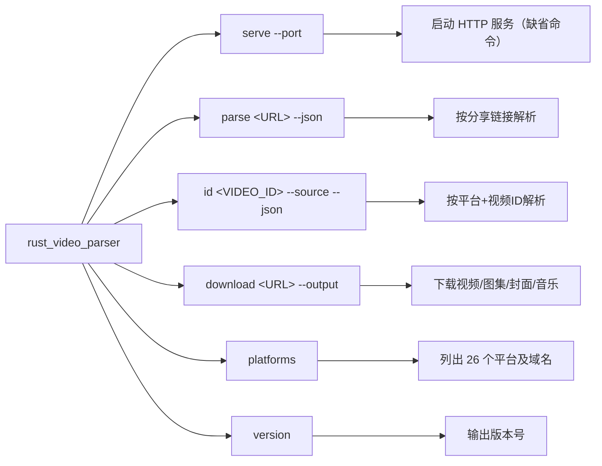

CLI 覆盖服务端的全部解析能力，`parse` / `id` 支持 `--json` 输出（结构与 HTTP API 响应完全一致，便于脚本集成）。资源代理、Web UI、限流与认证属于 HTTP 运行时能力，仅在 `serve` 模式下提供。

| 命令 | 对应 HTTP 接口 | 说明 |
| --- | --- | --- |
| `serve [--port <PORT>]` | — | 启动 HTTP 服务（缺省命令，直接运行二进制亦默认启动服务） |
| `parse <URL> [--json]` | `/api/video/share/url/parse` | 按分享链接解析，输出标题、作者、地址 |
| `id <VIDEO_ID> --source <SOURCE> [--json]` | `/api/video/id/parse` | 按平台标识与视频 ID 解析 |
| `download <URL> [--output <DIR>]` | — | 解析并下载视频 / 图集 / 封面 / 音乐（默认 `downloads`） |
| `platforms` | `/api/platforms` | 列出全部受支持平台及其域名 |
| `version` | — | 输出版本号 |

> **命令名称说明**：npm 安装后命令为 `rust-video`；直接下载二进制或源码构建后为 `rust_video_parser`（位于 `./target/release/rust_video_parser`）；Docker 容器内为 `rust_video_parser`（可通过 `docker exec` 调用）。下文示例以 **`rust-video`**（npm 推荐方式）为准，其他方式请替换命令名。

### 查看帮助

```console
$ rust-video --help
短视频去水印解析工具 - 支持26个平台

Usage: rust-video [OPTIONS] [COMMAND]

Commands:
  serve      启动HTTP服务器
  parse      解析单个分享链接并输出结果
  id         根据平台标识与视频 ID 解析（对应 HTTP 接口 /api/video/id/parse）
  download   解析并下载视频/图集到本地目录
  platforms  列出所有受支持的平台
  version    显示版本信息
  help       Print this message or the help of the given subcommand(s)

Options:
  -p, --port <PORT>  HTTP服务器端口（可由环境变量 SERVER_PORT 指定） [env: SERVER_PORT=] [default: 8080]
  -h, --help         Print help
  -V, --version      Print version

# 查看子命令帮助
$ rust-video id --help
```

### serve —— 启动 HTTP 服务

```console
$ rust-video serve --port 8080
2026-06-15T23:38:34.115+08:00  INFO rust_video_parser::server: 视频解析服务正在启动 version="2.1.0"
2026-06-15T23:38:34.115+08:00  INFO rust_video_parser::server: 限流策略已配置 rate_limit_rpm=60
2026-06-15T23:38:34.115+08:00  INFO rust_video_parser::server: Basic 认证策略已配置 enabled=false
2026-06-15T23:38:34.116+08:00  INFO rust_video_parser::server: HTTP 服务已就绪, 开始监听 addr=0.0.0.0:8080
```

```console
# 经环境变量指定端口与认证（等价于 --port）
$ SERVER_PORT=9000 PARSE_VIDEO_USERNAME=admin PARSE_VIDEO_PASSWORD=secret rust_video_parser serve
```

### parse —— 解析单条链接

```console
$ rust-video parse "https://v.douyin.com/xxxxxx/"
正在解析视频...
提取到链接: https://v.douyin.com/xxxxxx/
解析成功
标题: 示例视频标题
作者: 作者昵称 (MS4wLjABAAAA...)
视频地址: https://v3-web.douyinvod.com/...
封面地址: https://p3-sign.douyinpic.com/...
```

加 `--json` 输出与 HTTP API 完全一致的响应结构，适合脚本处理（可配合 `jq`）：

```console
$ rust-video parse "https://v.douyin.com/xxxxxx/" --json
{
  "code": 200,
  "msg": "解析成功",
  "data": {
    "author": { "uid": "MS4wLjABAAAA...", "name": "作者昵称", "avatar": "https://..." },
    "title": "示例视频标题",
    "video_url": "https://v3-web.douyinvod.com/...",
    "cover_url": "https://p3-sign.douyinpic.com/..."
  }
}

# 提取直链
$ rust-video parse "https://v.douyin.com/xxxxxx/" --json | jq -r '.data.video_url'
```

> 入参可直接粘贴含链接的整段分享文案，程序会自动用正则提取其中的 URL。

### id —— 按平台与视频 ID 解析

对应 HTTP 接口 `/api/video/id/parse`，需用 `--source` 指定平台标识（见 `platforms`）；部分平台不支持按 ID 解析。

```console
$ rust-video id 7234567890123456789 --source douyin
正在解析视频...
解析成功
标题: 示例视频标题
作者: 作者昵称 (MS4wLjABAAAA...)
视频地址: https://v3-web.douyinvod.com/...

# JSON 输出（错误同样以统一结构返回）
$ rust-video id 123 --source notexist --json
{
  "code": 201,
  "msg": "不支持的平台: notexist（可用 platforms 命令查看支持列表）"
}
```

### download —— 解析并下载到本地

```console
$ rust-video download "https://v.douyin.com/xxxxxx/" --output ./media
正在解析视频...
解析成功: 示例视频标题
2026-06-15T23:40:10.231+08:00  INFO rust_video_parser::download: 开始下载视频 file="示例视频标题.mp4"
2026-06-15T23:40:12.880+08:00  INFO rust_video_parser::download: 开始下载封面 file="示例视频标题_cover.jpg"
2026-06-15T23:40:13.012+08:00  INFO rust_video_parser::download: 媒体下载完成 count=2 dir="./media"
```

产物命名规则：视频 `<标题>.mp4`、封面 `<标题>_cover.jpg`、音乐 `<标题>_music.mp3`、图集 `<标题>_001.jpg`（含 LivePhoto 时追加 `_001_live.mp4`）。

### platforms —— 列出受支持平台

```console
$ rust-video platforms
受支持的视频平台:

 1. 抖音 (douyin)
    域名: v.douyin.com, www.iesdouyin.com, www.douyin.com
 2. 快手 (kuaishou)
    域名: v.kuaishou.com, www.kuaishou.com
 ...
26. Twitter (twitter)
    域名: x.com, twitter.com, t.co

合计 26 个平台
```

### version —— 输出版本

```console
$ rust-video version
rust_video_parser 2.3.3
```

### 在容器中调用

```console
# 解析（容器已运行时）
$ docker exec rust_video_parser rust_video_parser parse "https://v.douyin.com/xxxxxx/"

# 下载到容器内挂载目录
$ docker exec rust_video_parser rust_video_parser download "https://..." --output /app/downloads
```

---

## HTTP API 参考

- Base URL：`http://<host>:<port>`
- 响应类型：`application/json`（代理接口除外）
- 统一响应结构：`{ "code": <int>, "msg": <string>, "data": <object|null> }`，成功 `code=200`，失败 `code=201`

### 健康检查

```http
GET /api/health
```

```json
{ "status": "ok", "version": "2.3.3", "time": "2026-08-17T12:50:00+08:00" }
```

### 解析分享链接

```http
GET /api/video/share/url/parse?url=<分享链接或含链接的文本>
```

```json
{
  "code": 200,
  "msg": "解析成功",
  "data": {
    "author": { "uid": "...", "name": "作者昵称", "avatar": "https://..." },
    "title": "视频标题",
    "video_url": "https://...",
    "music_url": "https://...",
    "cover_url": "https://...",
    "images": [
      {
        "url": "https://.../photo.jpeg",
        "live_photo_url": "https://.../live-photo.mp4"
      }
    ]
  }
}
```

`live_photo_url` 为可选字段，仅在上游数据明确提供实况视频时返回。普通图片仍只返回 `url`。

### 按平台与视频 ID 解析

```http
GET /api/video/id/parse?source=<平台标识>&video_id=<视频ID>
```

`source` 取值见[平台支持矩阵](#平台支持矩阵)的「标识」列，部分平台不支持按 ID 解析。

### 平台列表

```http
GET /api/platforms
```

### 资源代理

```http
GET /api/proxy/video?url=<视频地址>      # 支持 Range 透传与流式转发
GET /api/proxy/image?url=<图片地址>
```

代理接口用于规避防盗链与跨域限制，并内置 SSRF 校验（详见[安全特性](#安全特性)）。

视频代理的 Range 透传与流式转发时序如下：

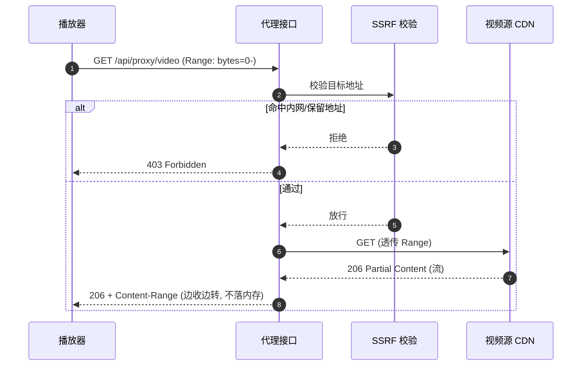

### 数据模型

响应体由统一包装 `HttpResponse<T>` 与解析结果 `VideoParseInfo` 构成，作者信息内联，图集为一对多：

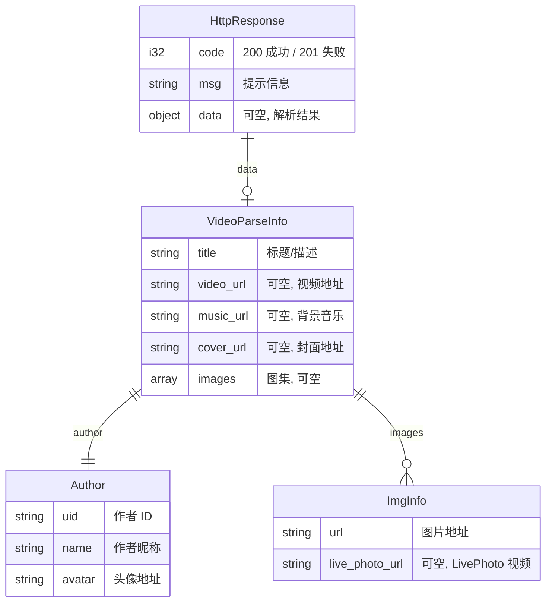

---

## 安全特性

| 能力 | 说明 |
| --- | --- |
| SSRF 防护 | 代理接口仅放行 `http/https`，经 DNS 解析后拦截环回、私有（10/172.16/192.168）、链路本地（169.254，含云元数据 `169.254.169.254`）、未指定、组播及 IPv6 ULA/链路本地地址 |
| Basic 认证 | 配置 `PARSE_VIDEO_USERNAME` 与 `PARSE_VIDEO_PASSWORD` 后启用；首页、健康检查、平台列表、静态资源豁免 |
| 速率限制 | 按客户端 IP 固定窗口限流（`RATE_LIMIT_RPM`），超限返回 `429` |
| 出站代理 | 通过 `PARSE_VIDEO_PROXY` 统一为解析与下载请求配置代理出口 |
| 优雅关闭 | 监听中断信号，停止接收新连接并完成在途请求后退出 |
| 最小权限 | 容器以非 root 用户运行，发布镜像不含构建工具链 |

### SSRF 校验决策

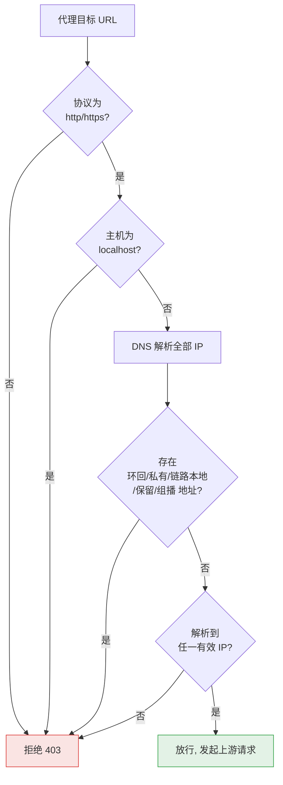

---

## 可观测性与日志

服务采用 `tracing` 结构化日志，输出包含本地时区时间戳、日志级别、模块路径与键值字段，便于采集与检索：

```
2026-06-15T23:38:34.115+08:00  INFO rust_video_parser::server: HTTP 服务已就绪, 开始监听 addr=0.0.0.0:8080
2026-06-15T23:38:36.702+08:00  INFO rust_video_parser::server: 请求处理完成 client_ip=127.0.0.1 method=GET path=/api/health status=200 latency_ms="0.23"
```

日志级别通过 `RUST_LOG` 控制，遵循 `tracing` EnvFilter 语法：

```bash
RUST_LOG=info                                   # 默认级别
RUST_LOG=rust_video_parser=debug                # 开启解析器调试日志
RUST_LOG=warn,rust_video_parser::server=info    # 仅服务模块 info，其余 warn
```

健康检查端点 `GET /api/health` 可用于容器编排的存活/就绪探针。

---

## 平台支持矩阵

| # | 平台 | 标识 | 视频 | 图集 | 封面 | 备注 |
|:--:|------|------|:--:|:--:|:--:|------|
| 1 | 抖音 | `douyin` | ✓ | ✓ | ✓ | Douyin |
| 2 | 快手 | `kuaishou` | ✓ | ✓ | ✓ | Kuaishou |
| 3 | 哔哩哔哩 | `bilibili` | ✓ | — | ✓ | Bilibili |
| 4 | 小红书 | `redbook` | ✓ | ✓ | ✓ | XiaoHongShu |
| 5 | 微博 | `weibo` | ✓ | ✓ | ✓ | Weibo |
| 6 | 西瓜视频 | `xigua` | ✓ | — | ✓ | Xigua |
| 7 | 皮皮虾 | `pipixia` | ✓ | — | ✓ | PiPiXia |
| 8 | 微视 | `weishi` | ✓ | — | ✓ | Weishi |
| 9 | 火山 | `huoshan` | ✓ | — | ✓ | Huoshan |
| 10 | 最右 | `zuiyou` | ✓ | — | ✓ | ZuiYou |
| 11 | 绿洲 | `lvzhou` | ✓ | — | ✓ | LvZhou |
| 12 | 度小视 | `quanmin` | ✓ | — | ✓ | QuanMin |
| 13 | 梨视频 | `lishipin` | ✓ | — | ✓ | LiShiPin |
| 14 | 皮皮搞笑 | `pipigaoxiao` | ✓ | — | ✓ | PiPiGaoXiao |
| 15 | 虎牙 | `huya` | ✓ | — | ✓ | Huya |
| 16 | AcFun | `acfun` | ✓ | — | ✓ | AcFun |
| 17 | 逗拍 | `doupai` | ✓ | — | ✓ | DouPai |
| 18 | 美拍 | `meipai` | ✓ | — | ✓ | MeiPai |
| 19 | 全民K歌 | `quanminkge` | ✓ | — | ✓ | QuanMinKGe |
| 20 | 六间房 | `sixroom` | ✓ | — | ✓ | SixRoom |
| 21 | 新片场 | `xinpianchang` | ✓ | — | ✓ | XinPianChang |
| 22 | 好看视频 | `haokan` | ✓ | — | ✓ | Haokan |
| 23 | 央视网 | `cctv` | ✓ | — | ✓ | CCTV |
| 24 | 腾讯视频 | `qqvideo` | ✓ | — | ✓ | QQ Video |
| 25 | 搜狐视频 | `sohu` | ✓ | — | ✓ | Sohu |
| 26 | Twitter/X | `twitter` | ✓ | ✓ | ✓ | Twitter/X |

> 图例：`✓` 支持，`—` 不适用。

---

## 项目结构

```
rust_video/
├── src/
│   ├── main.rs            # CLI 入口、日志初始化
│   ├── server.rs          # HTTP 服务、中间件、代理、健康检查
│   ├── models.rs          # 数据模型与平台枚举
│   ├── download.rs        # 媒体下载（流式写入）
│   ├── utils.rs           # HTTP 客户端、URL 提取、出站代理
│   └── parser/            # 解析器层
│       ├── mod.rs         # VideoParser trait、域名识别、工厂分发
│       └── *.rs           # 26 个平台实现
├── frontend/              # Vue 3 + Vuetify 3 前端工程
├── templates/dist/        # 前端构建产物（rust-embed 编译期内嵌，仅提交 .gitkeep）
├── npm/                   # npm 分发
│   ├── rust-video-parser/ # 主包：bin 启动壳 + optionalDependencies
│   ├── <platform>-<arch>/ # 5 个平台子包（os/cpu 限定）
│   └── scripts/prepare.mjs# 版本同步脚本
├── .github/workflows/
│   └── npm-release.yml    # 跨平台交叉编译并发布 npm
├── Dockerfile             # 多阶段构建
├── docker-compose.yml
└── Cargo.toml
```

---

## 构建与测试

```bash
cargo build --release      # 发布构建（LTO + strip）
cargo test                 # 单元测试
cargo fmt                  # 代码格式化
cargo clippy               # 静态检查
```

测试覆盖解析器关键纯逻辑（ID 提取、令牌算法、混淆还原）、SSRF 地址判定与下载工具函数。

### 镜像多阶段构建流程

`Dockerfile` 采用三阶段构建：前端与后端分别在专用工具链镜像中编译，最终仅将二进制与静态产物拷入精简运行时，发布镜像不含任何构建工具链。

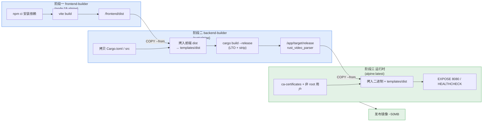

### npm 预编译分发模型

CLI 通过 npm 分发，采用 `optionalDependencies` 预编译二进制模型：主包仅含 JS 启动壳，各平台二进制独立成包并以 `os`/`cpu` 限定，npm 安装时只拉取与当前系统匹配的那一个。

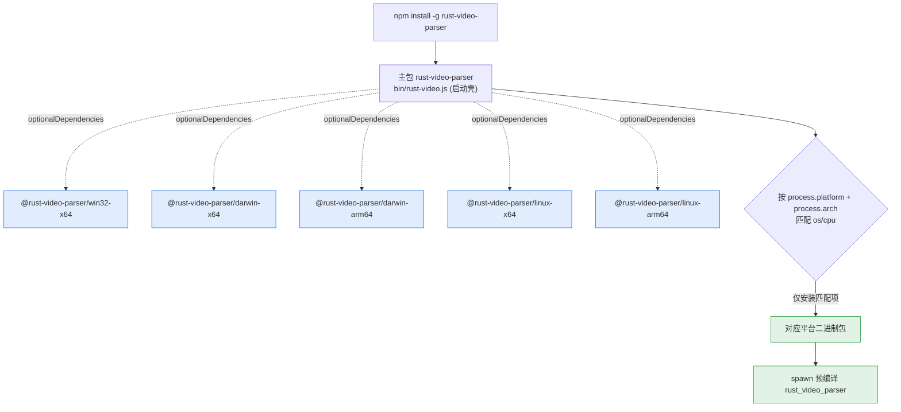

发布流程：推送 `v*` 标签 → GitHub Actions 矩阵交叉编译 5 平台（Linux 走 `cargo-zigbuild` 静态 musl，TLS 用 rustls 免系统依赖）→ 注入各子包 → `npm publish`。相关产物位于仓库 `npm/` 目录，版本由 `npm/scripts/prepare.mjs` 统一同步。

---

## 版本更新

### v2.3.3

- 抖音解析器新增完整 Web 详情接口回退，恢复实况照片动态视频地址。
- 图集解析兼容 `images`、`image_infos` 与 `image_post_info` 等结构。
- 图文作品可返回静态图、实况视频、封面和背景音乐。
- 新增实况照片网页预览、照片/实况切换及独立下载。
- 修复抖音视频 CDN 代理 `403`，支持 `200/206` 流式播放。
- 保持普通视频和普通图集的原有返回结构与下载流程。

### v2.3.2

- 增加抖音 WAF 工作量证明处理，提升 Debian 与 Docker 部署环境下的解析成功率。

---

## 性能参考

| 指标 | 量级 | 说明 |
| --- | --- | --- |
| 解析响应 | < 100 ms | 不含上游平台网络耗时 |
| 内存占用 | 约 50–512 MB | 取决于并发与视频代理流量 |
| 冷启动 | 约 5 s | 容器启动至就绪 |
| 镜像体积 | 约 50 MB | Alpine + 静态链接 |

> 实际数值受上游平台、网络环境与硬件配置影响，以上为参考量级。

---

## 免责声明

本项目仅供学习与技术研究使用。请勿用于商业或非法用途；解析所得内容版权归原作者所有；使用本工具产生的任何后果由使用者自行承担，请遵守相关平台服务条款与法律法规。

---

## 许可证

本项目基于 [MIT License](LICENSE) 开源。

## 致谢

感谢 Rust、Tokio、Axum、Vue、Vite 及相关开源社区的贡献者。
